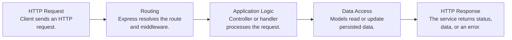

# Backend JS Mastery

A Node.js backend demonstrating modular routing, middleware, configuration, models, and controllers.

## Overview

The repository contains an implemented application or analysis project with code organized around its primary runtime, interface, data, or automation responsibilities.

## Key Features

- Node.js command execution or server runtime
- Modular source organization
- External I/O or API integration
- Scripted or interactive output

## Technology Stack

| Area | Technology |
|---|---|
| Platform | Node.js |
| Library / Framework / Tool | Express |
| Library / Framework / Tool | MongoDB |
| Library / Framework / Tool | JavaScript |

## Architecture and Data Flow

| Stage | Responsibility |
|---|---|
| **HTTP Request** | Client sends an HTTP request. |
| **Routing** | Express resolves the route and middleware. |
| **Application Logic** | Controller or handler processes the request. |
| **Data Access** | Models read or update persisted data. |
| **HTTP Response** | The service returns status, data, or an error. |

## Repository Structure

- `.gitignore`
- `app.js`
- `auth.route.js`
- `config`
- `controllers`
- `Database`
- `eslint.config.js`
- `middlewares`
- `models`
- `package-lock.json`
- `package.json`
- `subscription.route.js`
- `user.route.js`

## Setup

1. Install Node.js and npm.
2. Run `npm install` from the repository root.
3. Start the project with the applicable script below.

## Usage

- `npm run start` — node app.js
- `npm run dev` — nodemon app.js

## Configuration

Review `package.json` for available scripts and runtime dependencies. Add environment variables locally only when a feature requires external credentials or service configuration.

## Verification

- Run the project using the scripts in `package.json` and verify the primary user or API flow.
