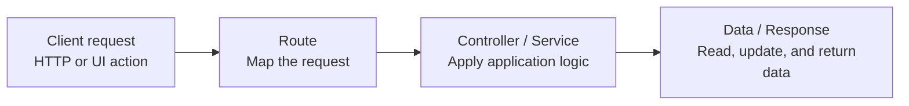

# Backend JS Mastery

**Portfolio project** · A Node.js backend practice project covering application structure, configuration, models, controllers, and authentication.

## Overview

A Node.js backend practice project covering application structure, configuration, models, controllers, and authentication.

## Technology Stack

- `Node.js`
- `Express`
- `MongoDB/Mongoose`
- `REST APIs`
- `JavaScript`

## How the Repository Works

| Stage | Responsibility |
|---|---|
| **Client request** | HTTP or UI action |
| **Route** | Map the request |
| **Controller / Service** | Apply application logic |
| **Data / Response** | Read, update, and return data |

## Concepts Covered

- JavaScript runtime
- Asynchronous I/O
- Modules and packages
- HTTP or CLI workflows
- External integrations

## Repository Map

- `.gitignore`
- `app.js`
- `auth.route.js`
- `config`
- `controllers`
- `Database`
- `eslint.config.js`
- `middlewares`
- `models`
- `package-lock.json`
- `package.json`
- `subscription.route.js`

## Recruiter Summary

This repository demonstrates practical implementation skills, repository organization, and an end-to-end understanding of the project workflow. It is suitable as a focused example of applied software or data work.

---

Documentation is concise and project-focused; source code was not modified.
